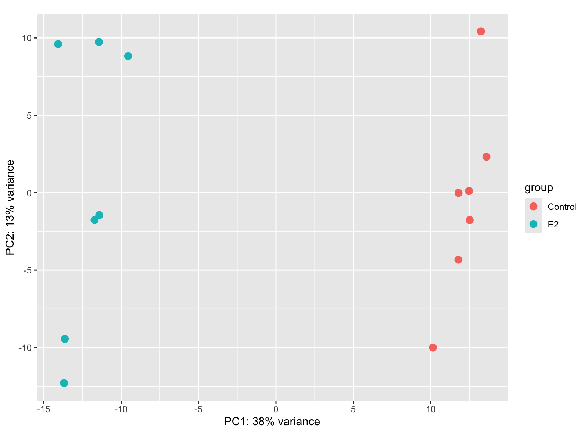
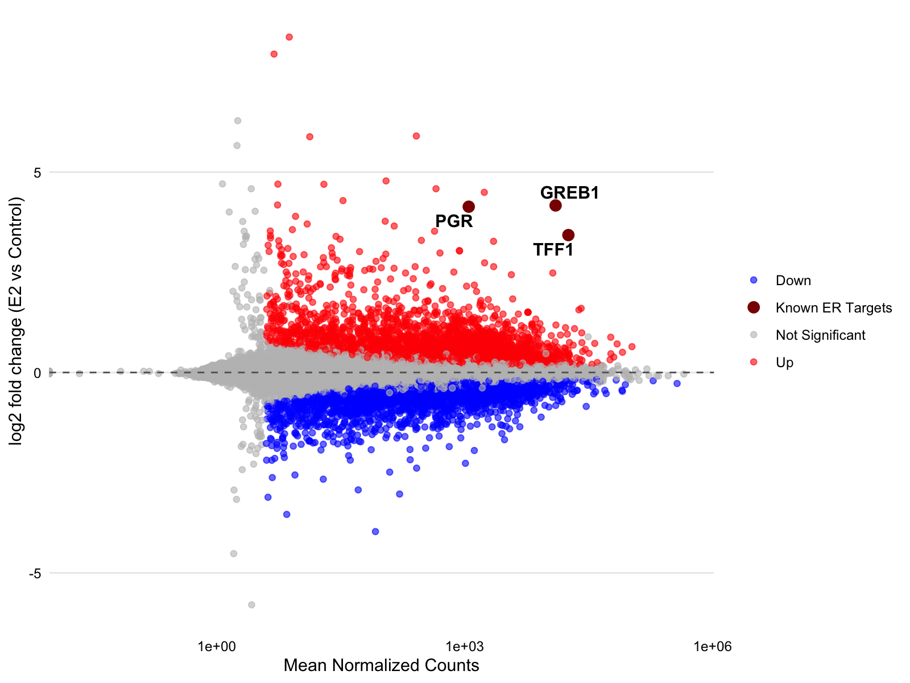
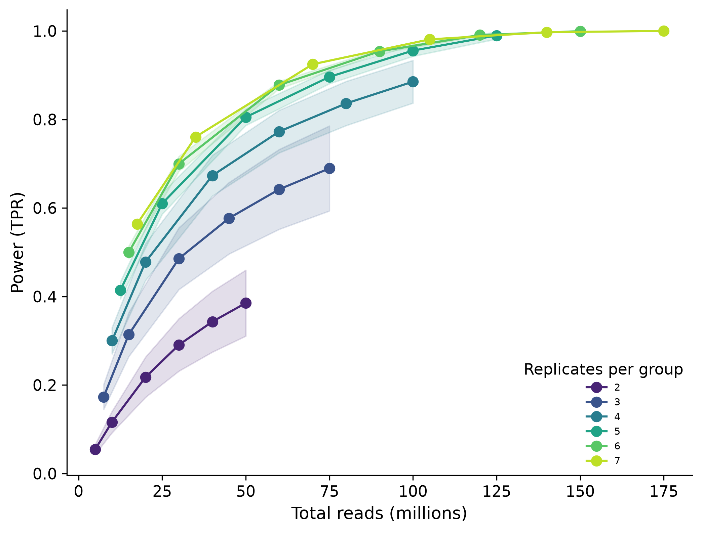
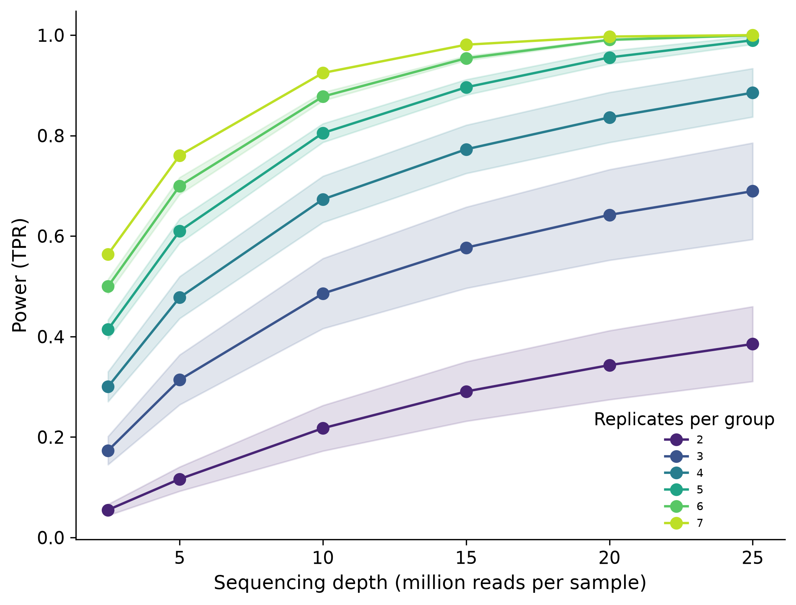
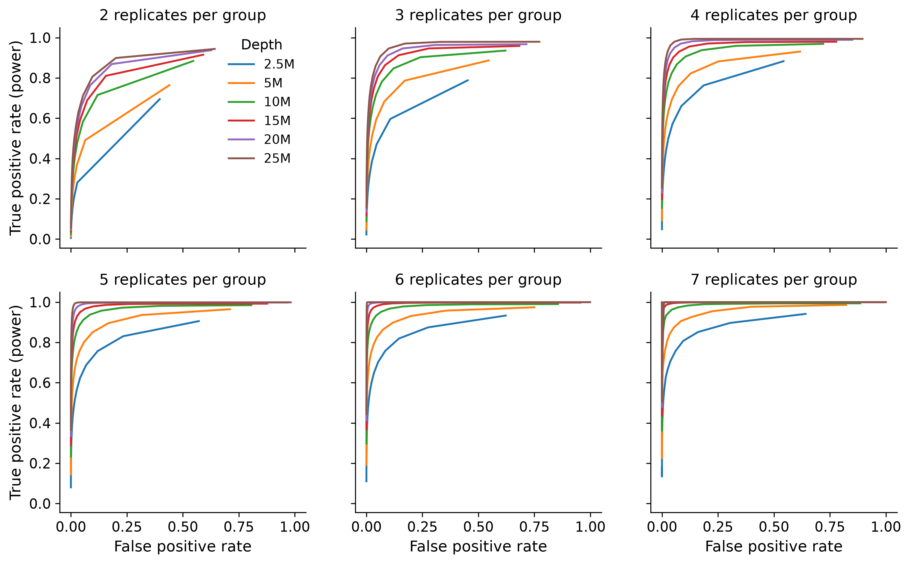
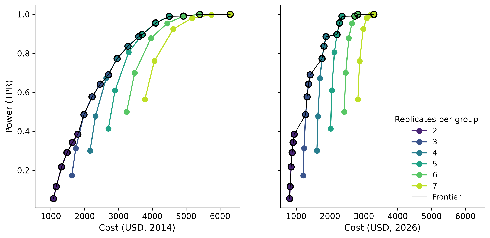

# With a fixed sequencing budget, is it better to add replicates or sequence deeper? 

This project reproduces the results from the paper by Liu et al., 2014 using a modern pipeline of Kallisto + DESeq2 + Nextflow, containerized with Docker. The project also provides additional insight regarding marginal gains in power by analyzing sequencing costs in 2026. 

Researchers should try to maximize depth until the budget can cover another replicate, as the cost for extra depth sequencing has become incredibly cheap. Marginal value of depth rose 5.3X since 2014 while the marginal value of additional replicates rose only 1.5-1.9x at 10-25M reads. Still, if budget can cover more replicates, researchers should do so. We confirmed that more replicates improved power more than increasing depth; there are diminishing returns beyond a certain depth. Adding replicates always increases power regardless of depth within the range tested (2-7 replicates, up to 25 M reads). 

## Quality Checks:

  
  

Figure 1: PCA plot (left) shows E2 treatment group and control group are well separated. However, variation within each group is high. MA plot (right) shows a total of 7104 up-regulated and down-regulated genes at full read depth (padj < 0.05, Benjamin-Hochberg). Three canonical ER genes (GREB1, PGR, TFF1) are highlighted and enlarged in dark red. 

## Results:

    
  

Figure 2: Left shows power versus total reads for replicate counts 2-7 (&plusmn;1 s.d). With replicate = 7, there is no variation as there is only one draw. For the same total number reads, having additional replicates always results in more power within the range of replicates and depths tested. Right shows power versus depth for replicate counts 2-7 (s.&plusmn;1 s.d). Increasing depth leads to diminishing returns for all 7 replicates. Increasing replicates always results in more power regardless of depth.

Figure 3: Receiver Operating Characteristic (ROC) curves for all replicate counts. True positive rate increases while false positive rate decreases as more replicates are added.

Figure 4. Power versus total experiment cost at 2014 prices (left) and 2026 prices (right). Each line is one replicate count (2–7 per group), and each point along a line is a sequencing depth (2.5–25M reads per sample); power is the mean over 20 random draws. The black line marks the cost-efficient frontier: the highest-power design available at each budget. Costs are 2n × (library prep + price per million reads × depth), using $250 per library and $8.00 per million reads for 2014 (Liu et al., 2014), and $198 per library (stranded mRNA-seq) and $1.50 per million reads (shared NovaSeq X lane) for 2026 (Northwestern NUSeq Core external rates, FY26). In both years, the frontier follows the same pattern: it increases depth with the current replicate count until another replicate becomes affordable, then switches to that replicate at a lower depth. What changed is the price of each step. Since 2014, the marginal value of extra depth rose about 5.3-fold, while that of an extra replicate rose only 1.5–1.9-fold (at 10–25M reads), because library prep, the main cost of a replicate, has barely gotten cheaper. At 2026 prices, extra depth is nearly free, so the budget mainly determines how many replicates are affordable. The 7-replicate, 25M design is the truth set itself, so its power is 1 by construction.

## Data
Uses data from GSE51403 (MCF7 cells, 7 control vs 7 estradiol-treated replicates) https://www.ncbi.nlm.nih.gov/geo/query/acc.cgi?acc=GSE51403

Original Paper by Liu et al., 2014: https://academic.oup.com/bioinformatics/article/30/3/301/228651#493686834
