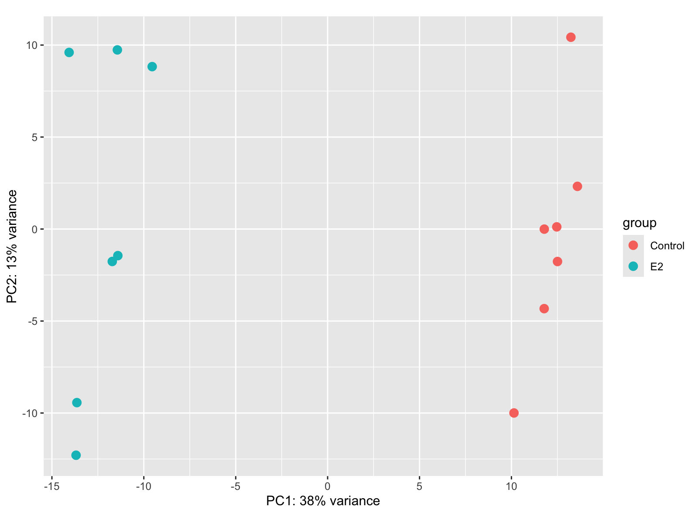
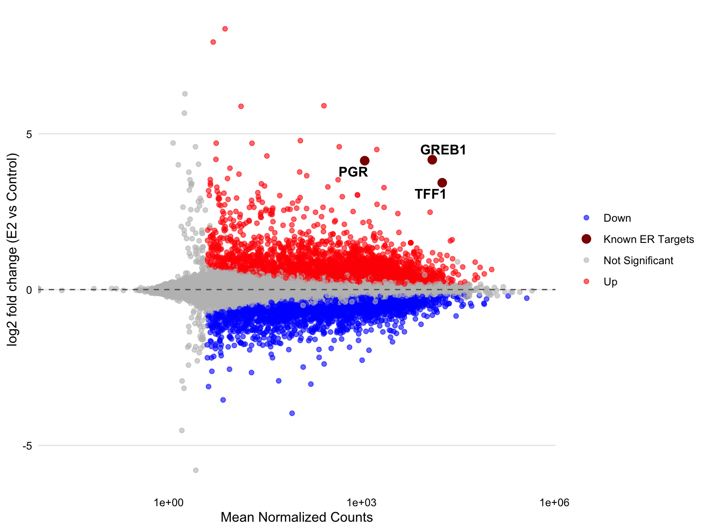
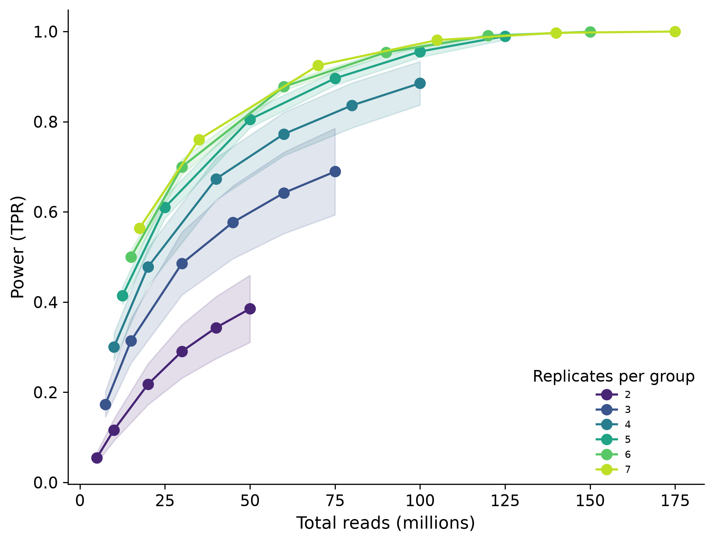
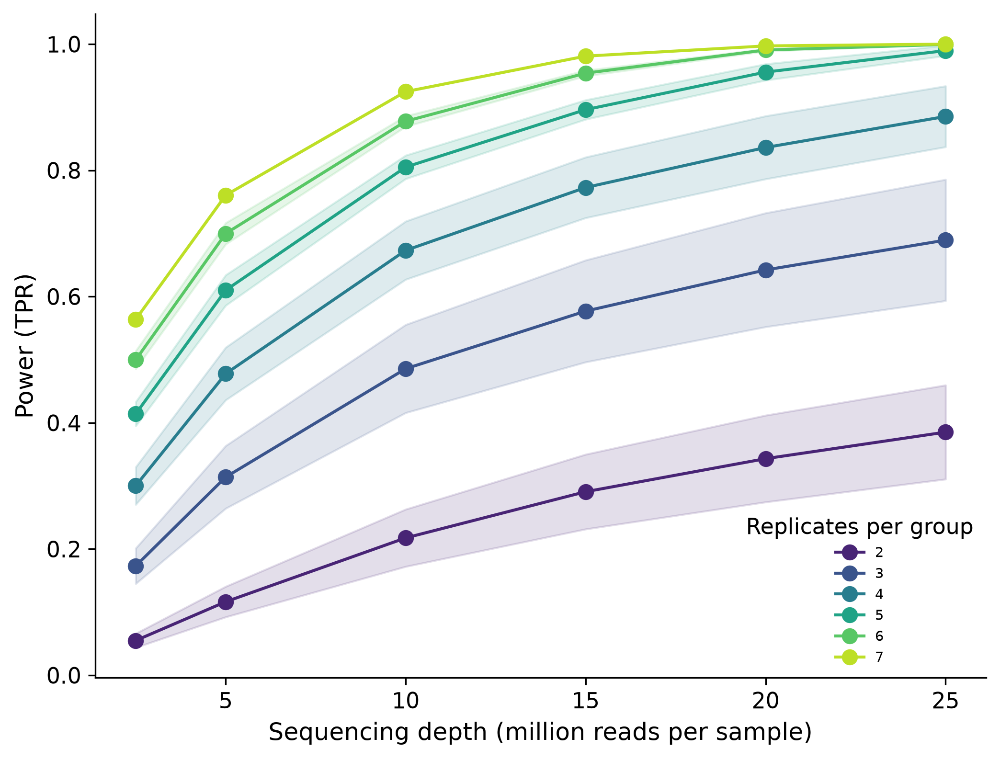
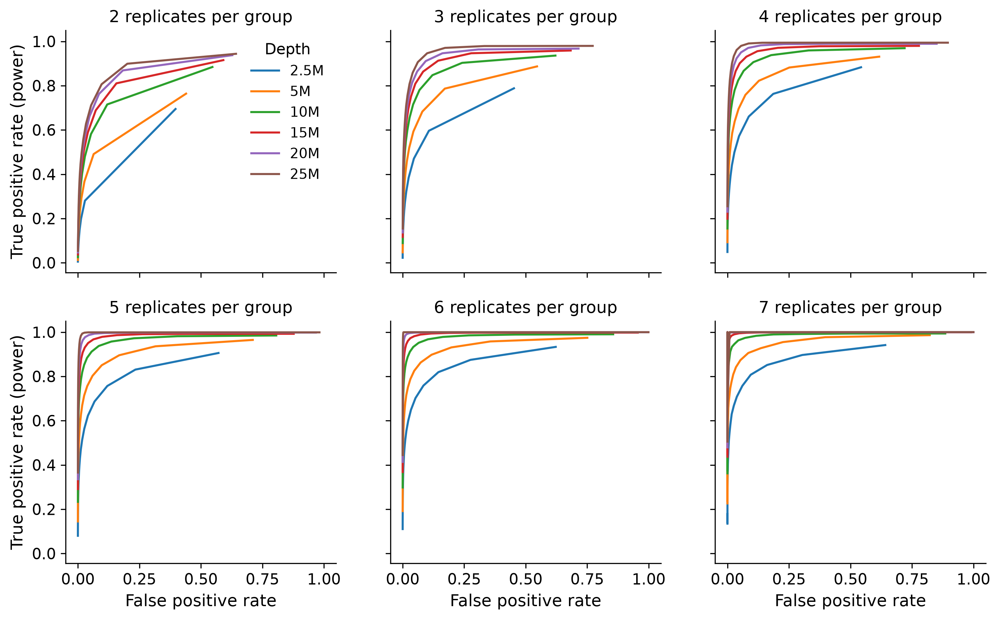
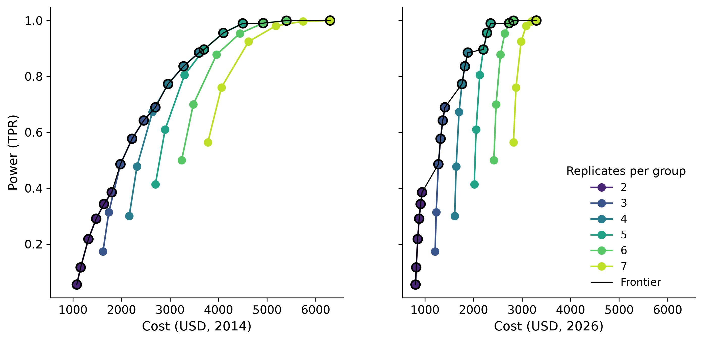

# With a fixed sequencing budget, is it better to add replicates or sequence deeper? 

This project reproduces the results from the paper by Liu et al., 2014 using a modern pipeline of Kallisto + DESeq2 + Nextflow, containerized with Docker. The project also provides additional insight regarding marginal gains in power by analyzing sequencing costs in 2026. 

Researchers should try to maximize depth until the budget can cover another replicate, as the cost for extra depth sequencing has become incredibly cheap. Marginal value of depth rose 5.3X since 2014 while the marginal value of additional replicates rose only 1.5-1.9x at 10-25M reads. Still, if budget can cover more replicates, researchers should do so. We confirmed that more replicates improved power more than increasing depth; there are diminishing returns beyond a certain depth. Adding replicates always increases power regardless of depth within the range tested (2-7 replicates, up to 25 M reads). 

## Quick Start

### Requirements
- [Nextflow](https://www.nextflow.io/) ≥ 25.10
- [Docker](https://www.docker.com/), with at least ~24 GB of memory allocated to Docker
- A machine with ≥ 32 GB RAM and plenty of free disk space (raw FASTQs, subsampled reads, and intermediate files together take tens of GB)

### 1. Clone the repository

``` bash
git clone https://github.com/Jason12345C/depth-vs-replicates.git
cd depth-vs-replicates
```
### 2. Build the docker images
```
docker build -t depth-vs-replicates:0.2 -f docker/Dockerfile docker/
docker build -t depth-vs-replicates-r:0.1 -f docker/Dockerfile.r docker/
```

### 3. Run the pipeline
```
nextflow run main.nf -profile full
```
### Outputs
Results are written to `results/`
| Folder | Contents |
|---|---|
| `samplesheet/` | Generated samplesheet (one row per sequencing run) |
| `fastqc/`, `multiqc/` | Per-lane QC reports and the combined MultiQC report |
| `kallisto/` | Quantification for every sample at every depth |
| `ref/` | Built kallisto index |
| `analysis/deseq/` | Full-depth DE results, ranked DE genes, MA plot |
| `analysis/` | Truth set, clear negatives, `power_runs.csv`, `roc_runs.csv` |

## Quality Checks:

<p float="left">
  
  
</p>
Figure 1. PCA plot (left) shows E2 treatment group and control group are well separated. However, variation within each group is high. MA plot (right) shows a total of 7104 up-regulated and down-regulated genes at full read depth (padj < 0.05, Benjamin-Hochberg). Three canonical ER genes (GREB1, PGR, TFF1) are highlighted and enlarged in dark red. 


## Results:
<p float="left">
    
  
</p>
Figure 2. Left shows power versus total reads for replicate counts 2-7 (&plusmn;1 s.d). With replicate = 7, there is no variation as there is only one draw. For the same total number reads, having additional replicates always results in more power within the range of replicates and depths tested. Right shows power versus depth for replicate counts 2-7 (s.&plusmn;1 s.d). Increasing depth leads to diminishing returns for all 7 replicates. Increasing replicates always results in more power regardless of depth.


Figure 3. Receiver Operating Characteristic (ROC) curves for all replicate counts. True positive rate increases while false positive rate decreases as more replicates are added.

<p>

</p>
Figure 4. Power versus total experiment cost at 2014 prices (left) and 2026 prices (right). Each line is one replicate count (2–7 per group), and each point along a line is a sequencing depth (2.5–25M reads per sample); power is the mean over 20 random draws. The black line marks the cost-efficient frontier: the highest-power design available at each budget. Costs are 2n × (library prep + price per million reads × depth), using $250 per library and $8.00 per million reads for 2014 (Liu et al., 2014), and $198 per library (stranded mRNA-seq) and $1.50 per million reads (shared NovaSeq X lane) for 2026 (Northwestern NUSeq Core external rates, FY26). In both years, the frontier follows the same pattern: it increases depth with the current replicate count until another replicate becomes affordable, then switches to that replicate at a lower depth. What changed is the price of each step. Since 2014, the marginal value of extra depth rose about 5.3-fold, while that of an extra replicate rose only 1.5–1.9-fold (at 10–25M reads), because library prep, the main cost of a replicate, has barely gotten cheaper. At 2026 prices, extra depth is nearly free, so the budget mainly determines how many replicates are affordable. The 7-replicate, 25M design is the truth set itself, so its power is 1 by construction.

## Methods

### Samplesheet
A samplesheet was generated from the SRA run metadata. Each run was assigned to its biological sample using its BioSample ID, and labelled Control or E2 by treatment (sample names `ctrl_0`–`ctrl_6` and `e2_0`–`e2_6`). Runs from the same BioSample share a sample name.

### Download and QC
FASTQ files were downloaded from ENA and verified against ENA's MD5 checksums; any file that failed verification was downloaded again. Each run was checked with FastQC, and all reports were combined with MultiQC.

### Reference
Transcripts were taken from Ensembl release 116 (GRCh38), combining the cDNA and ncRNA FASTA files. These were used to build the kallisto index and a transcript-to-gene table, parsed from the FASTA headers.

### Lane merging and subsampling
Runs were merged by sample, giving one FASTQ file per biological sample (14 in total). Each merged file was subsampled with seqtk (fixed seed 42) to 2.5, 5, 10, 15, 20, and 25 million reads. The full-depth files (about 26.6–70 million reads per sample) were also kept.

### Quantification
Every sample was quantified at every depth with kallisto 0.52.0 in single-end mode (`-l 200 -s 20`). Transcript estimates were summarized to gene level with tximport.

### Differential expression (full depth)
DESeq2 was run on all 14 samples at full depth, comparing E2 against Control (Control as reference level). Genes with fewer than 10 total counts were removed. Genes were called differentially expressed at a Benjamini–Hochberg adjusted p-value (padj) below 0.05, giving about 7,100 genes. Shrunken log2 fold changes (apeglm) were used for ranking and for the MA plot. The canonical estrogen-responsive genes GREB1, PGR, and TFF1 were among the most strongly upregulated, confirming the pipeline recovers known biology.

### Truth set
A reference truth set was defined from all 14 samples at 25 million reads, the highest depth every sample reaches (the two shallowest samples have about 26.6 million reads). Using a common depth means no sample contributes more information than another. Genes with padj < 0.001 formed the truth set (about 3,500 genes). Genes with padj ≥ 0.1 were treated as clear negatives. Genes in between were excluded from scoring, because their true status is uncertain.

### Power simulation
For each replicate count n = 2–7, n samples were drawn at random from each group, 20 times (seed = draw number). Since only one 7-vs-7 combination exists, n = 7 was run once. Each draw used the same samples at every depth, so depth comparisons are paired. This gave 101 draws × 6 depths = 606 DESeq2 analyses, each scored against the truth set:
- **Power (true positive rate):** truth-set genes called at padj < 0.05, divided by the size of the truth set.
- **False positive rate:** clear negatives called, divided by the number of clear negatives.
- **Precision:** true positives divided by all scored calls (true positives plus false positives).

ROC curves were computed from each analysis's padj values at 40 log-spaced thresholds from 10⁻⁶ to 1, then averaged across draws.

### Cost analysis
The cost of each design was modelled as 2n × (library prep cost + price per million reads × depth):
- **2014:** $250 per library and $8.00 per million reads ($1,200 per lane of 150 million reads), from Liu et al. (2014).
- **2026:** $198 per library (stranded mRNA-seq, fewer than 96 samples) and $1.50 per million reads (shared NovaSeq X 10B lane), from the Northwestern NUSeq Core's FY26 external academic rates.

For each year, the cost-efficient frontier is the highest-power design available at each budget.

## Data
Uses data from GSE51403 (MCF7 cells, 7 control vs 7 estradiol-treated replicates) https://www.ncbi.nlm.nih.gov/geo/query/acc.cgi?acc=GSE51403

Original Paper by Liu et al., 2014: https://academic.oup.com/bioinformatics/article/30/3/301/228651#493686834

